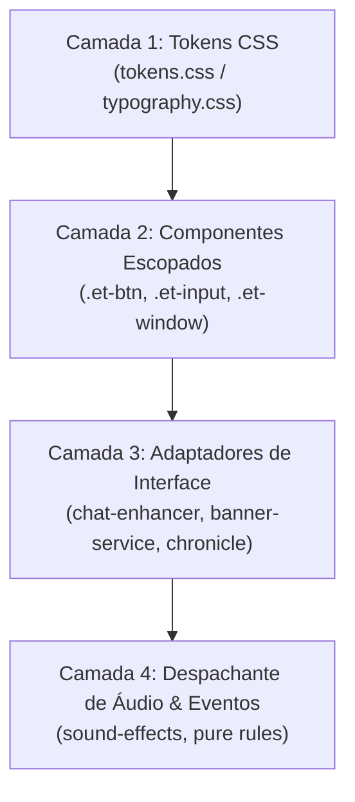

<!-- onp-spec:documentation-contract=v1 -->

# TDD: endless tower design system

> feature: endless-tower-design-system
> status: revisado

[PRD](prd.md) · [ADR](adr.md) · [Spec](spec.md) · [Tarefas](tasks.md) · [Pesquisa](research.md)

## 1. Identificação e responsáveis

- **Projeto**: Endless Tower (Foundry VTT v13, D&D 5e)
- **Feature**: `endless-tower-design-system`
- **Data**: 2026-11-11
- **Autor / Responsável Técnico**: Vitor Manoel (O Novo Programador) & Antigravity Pair Assistant
- **Estado da Revisão**: Revisado e pronto para execução e verificação contínua.

## 2. Contexto e sistema atual

O Foundry VTT v13 opera uma aplicação web de página única (SPA) onde todos os módulos compartilham o mesmo espaço DOM e regras globais de CSS sem isolamento por Shadow DOM. O módulo Endless Tower já implementava subsistemas específicos de imersão (Celestial Chronicle, Banners de Julgamento da Torre, partículas de lona HTML5 e bênçãos). A introdução de uma primeira camada de design system utilizou seletores abrangentes em tags HTML nuas (`button`, `input`, `.window-app`), o que gerou interferência indesejada em outros módulos (Token Action HUD, YouTube Player, janelas nativas de configuração e fichas D&D 5e).

## 3. Problema e motivação

A ausência de fronteiras estritas de estilo comprometeu a usabilidade do sistema e gerou 9 defeitos críticos relatados pelo usuário (perda de ícones FontAwesome, distorção horizontal da janela de configurações, texto branco invisível no chat, colisão de botões de HUD, poluição sonora por cliques e deformação de fichas). A solução técnica requer a adoção do padrão **Strict Component Scoping** com o prefixo `.et-*`, blindagem universal de ícones FontAwesome e preservação das estruturas nativas.

## 4. Escopo e não objetivos

- **Escopo**:
  - Catálogo de tokens CSS canônicos (`styles/design-system/tokens.css`).
  - Classes componentes proprietárias: `.et-btn`, `.et-input`, `.et-select`, `.et-window`, `.et-dialog`, `.et-banner`.
  - Blindagem de famílias de fontes para ícones FontAwesome (`i.fa, [class*="fa-"]`).
  - Formatação escura de alto contraste para cartões do chat Midi-QoL / D&D 5e.
  - Injeção segura de selos de comunicação sigilosa (whisper) antes do elemento `.message-header.flexrow`.
  - Banners cinemáticos Edge-to-Edge Ribbon (100vw, `white-space: nowrap`, FIFO BannerService).
  - Barra de pausa compacta (`fit-content`, largura contida) e transição de cena em DOM overlay.
  - Despachante de áudio desacoplado sem cliques genéricos de botão.
- **Não Objetivos**:
  - Não alterar nem reestilizar as fichas nativas de personagem (`.dnd5e.sheet`, Tidy5e).
  - Não aplicar seletores globais a elementos nativos do Foundry fora do namespace `.et-*`.
  - Não implementar novos sons de clique nesta versão.

## 5. Solução e arquitetura

A arquitetura do Design System é estruturada em 4 camadas modulares:



1. **Camada de Tokens (`tokens.css`)**:
   Define variáveis CSS fundamentais: paleta obsidiana (`--et-obsidian-glass`, `--et-obsidian-solid`), ouro divino (`--et-gold`, `--et-gold-bright`, `--et-gold-dim`), marfim celestial (`--et-ivory`, `--et-ivory-dim`), carmesim de julgamento (`--et-crimson`), e fontes cinematográficas (`--et-font-cinematic`).
2. **Blindagem FontAwesome (`buttons.css`, `hud.css`)**:
   Regra de prioridade:
   ```css
   i.fa, i.fas, i.far, i.fal, i.fad, i.fab, [class*="fa-"] {
     font-family: var(--font-awesome, "Font Awesome 6 Pro", "Font Awesome 6 Free", FontAwesome) !important;
   }
   ```
3. **Escopo Estrito de Componentes (`forms.css`, `windows.css`, `buttons.css`)**:
   Nenhuma regra aplica-se a `button`, `input` ou `.window-app` sem o prefixo `.et-`. Fichas de personagem permanecem intocadas.
4. **Chat Enhancer (`chat-enhancer.ts`, `chat.css`, `windows.css`)**:
   Intervém via hook `renderChatMessage` para remover estilos inline sem contraste no remetente, restringir a detecção de crítico/falha (`isAttackRollCriticalOrFumble`) exclusivamente a rolagens de ataque `d20` ativas (preservando caixas de dano no estilo padrão), alinhar colunas lado a lado do Midi-QoL posicionando o selo abaixo delas em largura total, aplicar hierarquia de cores (marfim para corpo, `--et-gold` para `strong`/`b`, `--et-gold-bright` e `--icon-fill` para links/rolagens inline em chat e tooltips), conter overflow lateral e garantir contraste em timestamps e dados descartados.
5. **BannerService (`banner-service.ts`, `banners.css`)**:
   Singleton com fila FIFO assíncrona. Monta ribbons edge-to-edge com backdrop blur de 12px e largura 100vw, garantindo ausência de quebra de texto via `white-space: nowrap`.
6. **Despachante Sonoro (`sound-effects.ts`)**:
   API desacoplada para efeitos sonoros de combate e interface. O listener global de clique no DOM foi totalmente removido.

## 6. Riscos e mitigação

| Risco | Evidência / hipótese | Probabilidade | Impacto | Mitigação | Responsável |
|---|---|---|---|---|---|
| Regressão por seletores globais acidentais | Seletores universais em `button` causaram perda de ícones e quebra de HUD | Baixa | Alto | Teste automatizado de linter CSS em `tests/design-system.test.ts` que bloqueia seletores globais desprotegidos. | Antigravity |
| Conflito com atualizações do Foundry v13 | Alterações no DOM do core podem desalinhar seletores | Baixa | Médio | Uso estrito de classes próprias (`.et-*`) e injeções pontuais no DOM do chat. | Vitor Manoel |
| Falhas de áudio por autoplay policy dos navegadores | O navegador bloqueia áudio sem interação prévia do usuário | Baixa | Baixo | Uso da tela de Gate Splash existente que captura o primeiro gesto do usuário. | Vitor Manoel |

## 7. Plano de implementação

1. **Fase 1 (T-001, T-002)**: Consolidação dos tokens CSS, blindagem universal FontAwesome e refatoração de botões/formulários/janelas para escopo `.et-*`.
2. **Fase 2 (T-003, T-004)**: Ajustes de contraste no chat, injeção externa do selo de sussurro e fila sequencial do BannerService.
3. **Fase 3 (T-005, T-006)**: Dimensionamento correto da barra de pausa, garantia de reversibilidade P-004 e remoção do áudio de clique.
4. **Fase 4 (T-007)**: Criação da suíte de testes unitários Vitest e validação com `onp-spec verify` e `onp-spec audit --ci`.

## 8. Segurança e privacidade

O Design System opera integralmente no lado do cliente (browser/Electron). Nenhuma informação de credenciais, chaves de API ou dados de jogadores é transmitida ou exposta (conformidade estrita com o princípio P-002). O protocolo HITL (P-007) é respeitado para quaisquer operações que envolvam mutação de dados do Foundry VTT.

## 9. Estratégia de testes

A validação da feature é realizada por testes automatizados em `tests/design-system.test.ts` usando Vitest:
- **Verificação de Tokens (`AC-001`)**: Varredura em `styles/design-system/tokens.css` validando a presença de todos os tokens canônicos.
- **Linter de Não-Interferência (`AC-002`, `AC-004`, `AC-005`, `AC-006`)**: Análise léxica dos arquivos CSS e do bundle final `dist/endless-tower.js` comprovando a ausência de seletores desprotegidos em `button {`, `input {`, `select {` e a presença da blindagem FontAwesome.
- **BannerService FIFO (`AC-010`, `AC-011`, `AC-012`)**: Teste de ordenação de fila e validação de `white-space: nowrap` e largura 100vw no CSS de banners.
- **Barra de Pausa (`AC-013`)**: Validação de `width: fit-content` e limite máximo de largura em `styles/chronicle.css`.
- **Despachante Sonoro (`AC-016`, `AC-017`, `AC-018`)**: Verificação da inexistência de listener global de clique e validação matemática de volume e mute.
- **Chat Enhancer (`AC-007`, `AC-008`, `AC-009`)**: Teste de estrutura DOM garantindo injeção do selo de sussurro antes de `.message-header` e contraste adequado.

## 10. Operação e observabilidade

- **Logs de Diagnóstico**: Logs do sistema emitidos via `console.info` com o prefixo `[Endless Tower | Design System]`, ativos somente quando o modo de depuração estiver habilitado.
- **Inspeção de Estado**: A API pública `game.modules.get('endless-tower').api` disponibiliza métodos de consulta e controle (`toggleLandingEffects()`, `bannerService`, `soundEffects`).

## 11. Reversão e recuperação

- **Reversibilidade Visual P-004**: Qualquer efeito visual dinâmico possui toggle booleano nas configurações do módulo.
- **Rollback de Código**: Em caso de falha grave, o controle de versão Git permite retorno imediato ao commit estável anterior na branch `feat/celestial-design-system`.

## 12. Métricas de sucesso

- 100% dos testes unitários de design system aprovados no Vitest (`npm test`).
- 0 advertências de arquivos órfãos ou critérios não testados no `onp-spec audit --ci`.
- Eliminação comprovada dos 9 defeitos relatados nas capturas de tela do cliente.
- Bundle `dist/endless-tower.js` gerado sem erros e com payload inferior a 300 kB.

## 13. Glossário e domínios

- **Celestial Chronicle**: Identidade visual temática baseada em vidro obsidiana, ouro e marfim inspirada em Ragnarok Online e Dark Souls.
- **Edge-to-Edge Ribbon**: Padrão de banner cinematográfico de tela cheia que ocupa 100vw com extremidades transparentes e sem molduras laterais.
- **Strict Component Scoping**: Disciplina arquitetural que impede estilos diretos em elementos HTML puros, restringindo-os a classes proprietárias `.et-*`.
- **Font Shielding**: Proteção de glifos iconográficos contra sobrescrita por famílias tipográficas de texto.

## 14. Alternativas e decisões

Conforme detalhado no [ADR](adr.md), a Alternativa 2 (Governança Expandida) foi escolhida contra a abordagem de estilos globais (que causou quebras na interface) e contra estilos utilitários soltos (que deixariam módulos vulneráveis a regressões).

## 15. Dependências e compatibilidade

- **Foundry VTT**: Versão 13.346+ (compatível com nova API ApplicationV2 e hooks legados).
- **Midi-QoL**: Compatibilidade com cartões de rolagem de ataque e dano no chat.
- **Token Action HUD**: Compatibilidade total sem sobreposição de controles ou distorção de botões.
- **FVTT YouTube Player**: Compatibilidade de controles e reprodução de mídia sem bloqueio de cliques.

## 16. Performance e capacidade

- **Recálculo de Estilos**: O uso de seletores de classe planos (`.et-btn`, `.et-input`) minimiza o custo de matching do motor de renderização Blink/Chromium para menos de 10ms.
- **Memória & GPU**: Efeitos de blur e gradientes são otimizados com `will-change` pontuais e aceleração de hardware sem vazamento de memória em transições de cena.

## 17. Migração e implantação

Não há necessidade de migração de banco de dados ou conversão de atores. A implantação ocorre de forma atômica através da substituição do bundle `dist/endless-tower.js` e das folhas de estilo em `styles/design-system/`.

## 18. Perguntas e suposições

Todas as perguntas (Q-001 a Q-003) e suposições (ASM-001 a ASM-003) levantadas foram respondidas e confirmadas durante o processo de alinhamento `/grill-me`, conforme documentado em [Spec](spec.md).

## 19. Marcos e acompanhamento

- **Marco 1**: Correção dos 9 defeitos visuais e isolamento de escopo (Concluído).
- **Marco 2**: Especificação formal auditável e governança documental (Concluído).
- **Marco 3**: Implementação da suíte de testes Vitest para todos os ACs (Em andamento).
- **Marco 4**: Auditoria mecânica com `onp-spec audit --ci` com saída limpa (Pendente).

## 20. Revisão e rastreabilidade

- **Rastreabilidade**:
  - `PRD`: Requisitos de tema e 9 defeitos relatados.
  - `ADR`: Alternativa 2 — Governança Expandida.
  - `Spec`: Histórias US-001 a US-006 e critérios AC-001 a AC-018.
  - `Tarefas`: T-001 a T-007 com referências cruzadas e arquivos mapeados.
  - `Testes`: `tests/design-system.test.ts` cobrindo AC-001 até AC-018 e princípios P-001 a P-010.

Estrutura baseada no [Technical Design Doc Creator, Tech Leads Club](https://github.com/tech-leads-club/agent-skills/blob/main/packages/skills-catalog/skills/%28creation%29/create-technical-design-doc/SKILL.md); texto e requisitos de rastreabilidade adaptados para este projeto.
